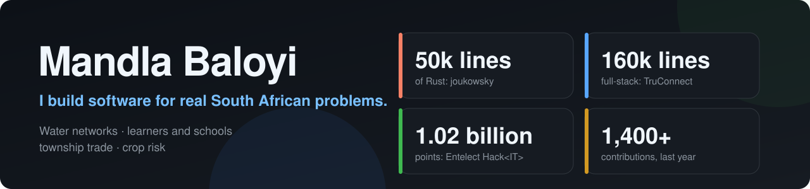

  

Hi, I am Mandla. I build software for problems around me in South Africa: pipes that leak, learners choosing what to study, township traders who run on paper, farmers facing drought. I like work where the data is messy, the claims have to be checked, and the result is something a real person can use.

**Right now** I am building **TRY**, a free app that helps South African learners study, find courses and bursaries, and plan what comes next. It runs on AWS with a Flask backend, an Expo app, and an AI assistant whose answers are grounded in real data. It is private for now, so the projects below are the public record.

## Featured work

| Project | What it is | The proof |
|---|---|---|
| [**joukowsky**](https://github.com/MandlaBaloyi/joukowsky) | A Rust engine that hears a pipe burst in the pressure data and finds it on the network | 50k lines, zero external crates, physics checked against exact answers |
| [**TRU-Connect**](https://github.com/MandlaBaloyi/TRU-Connect) | Business tools for South Africa's informal economy: order book, loan book, supplier network | Flask, Expo and Next.js, 1,400+ backend tests |
| [**KasiFlow**](https://github.com/MandlaBaloyi/KasiFlow) | Akayza: credit book, orders and card payments for township traders, with sealed records | Team entry, selected out of 151 teams at GKHack26 |
| [**msindex**](https://github.com/MandlaBaloyi/msindex) | Parametric maize insurance from satellite data: a priced, sealed drought trigger | Pays 75% of real losses against 50% for rainfall, on seasons it never saw |
| [**lp-dev-dataquest**](https://github.com/MandlaBaloyi/lp-dev-dataquest) | Ranks South African schools by the risk of losing learners | Test AUC 0.687, and the failed first model is reported, not hidden |
| [**plant-ecosystem-optimizer**](https://github.com/MandlaBaloyi/plant-ecosystem-optimizer) | A solver for Entelect Hack&lt;IT&gt; 2026 | 1.02 billion points, found by reading the hidden engine's own logs |

## What I work with

| | |
|---|---|
| **Languages** | Python, TypeScript, SQL, Rust |
| **Backend** | Flask, SQLAlchemy, Alembic, PostgreSQL, JWT auth, Docker, AWS |
| **Mobile and web** | React Native, Expo, Next.js |
| **Data** | pandas, scikit-learn, Streamlit, Plotly, pdfplumber, rasterio |
| **AI** | LLM APIs, MCP tool servers, answers grounded in real data |
| **Quality** | pytest, Jest, GitHub Actions, gitleaks secret scanning |

## How I work

- **Test first, and say what failed.** My READMEs carry the limits and the failures next to the results. One of my data projects reports a model that barely beat chance, and why.
- **Numbers over adjectives.** Claims come with the measurement that backs them.
- **Security by habit.** No secrets in repos, input validated at the edge, personal data kept out of logs, and learner data never sent to third parties.
- **Docs that a newcomer can follow.** If a project needs a guide to run, it gets one.

## Where I can help on your project

If you maintain something and want a contributor, these are the areas where I am useful:

- Python and Flask APIs, with tests
- React Native and Expo screens, typed in TypeScript
- Data pipelines and model evaluation, including leakage checks
- Tests, docs and READMEs
- South African public data (DBE, Stats SA, EMIS, exam reports)

Open an issue or a discussion on any of my repos, or send a pull request to yours and tag me.

## 2026 so far

- **GKHack26 (Geekulcha):** selected out of 151 teams, with KasiFlow.
- **Entelect Hack&lt;IT&gt;:** 1.02 billion points; the leading entries finished near 1.4 to 1.7 billion.
- **LP Dev DataQuest:** two entries, a school-dropout early warning system and msIndex.
- **FNB App of the Year:** submitted TRY.

I am looking for **graduate programmes and junior software or data roles**, and for open-source projects where I can contribute.
